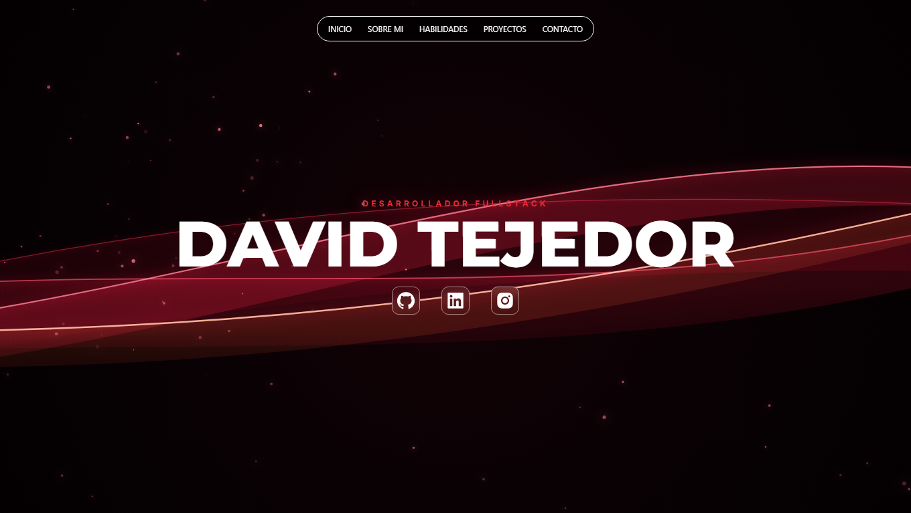

# 🚀 Portfolio Personal — David Tejedor

**Desarrollador Fullstack**



🌐 [Ver sitio web en vivo](https://david-tejedor-portfolio.vercel.app)

## Sobre el proyecto

Este repositorio contiene mi sitio web personal y portfolio profesional, diseñado para presentar mis proyectos, habilidades y trayectoria como Desarrollador Fullstack.

El proyecto utiliza Next.js 16 (App Router) y Tailwind CSS v4, priorizando la velocidad de carga, el tipado estático con TypeScript y una experiencia visual moderna con estética oscura.

## Tecnologías y herramientas

- **Framework:** Next.js 16 (App Router y Turbopack)
- **Lenguaje:** TypeScript
- **Estilos y diseño:** Tailwind CSS v4
- **Despliegue y CI/CD:** Vercel
- **Linter y calidad:** ESLint 9

## ✨ Características principales

- **Rendimiento optimizado:** páginas generadas estáticamente para una carga ultrarrápida.
- **Diseño responsive:** adaptación nativa a cualquier tamaño de pantalla.
- **Open Graph automatizado:** tarjeta de presentación personalizada (`opengraph-image.png`) para redes sociales, LinkedIn y WhatsApp.
- **UI limpia:** navegación fluida y scroll personalizado sin barras visibles.

## Estructura del proyecto

```
david-tejedor-portfolio/
├── public/                     # Archivos estáticos
└── src/
    ├── app/                    # Rutas y configuración de la app (App Router)
    │   ├── components/         # Componentes de UI reutilizables
    │   ├── favicon.ico
    │   ├── globals.css         # Estilos globales y utilidades de Tailwind v4
    │   ├── layout.tsx          # Layout principal y metadata global
    │   ├── opengraph-image.png # Vista previa para Open Graph
    │   └── page.tsx            # Página principal
    ├── assets/                 # Recursos multimedia e imágenes internas
    ├── config/                 # Variables y datos de configuración global
    └── data/                   # Información sobre proyectos, habilidades y logros
```

## 💻 Instalación y ejecución local

Si querés clonar y ejecutar este proyecto localmente:

1. Clonar el repositorio:

   ```bash
   git clone https://github.com/daviddtejedor/david-tejedor-portfolio.git
   cd david-tejedor-portfolio
   ```

2. Instalar dependencias:

   ```bash
   npm install
   ```

3. Iniciar el servidor de desarrollo:

   ```bash
   npm run dev
   ```

4. Abrir `http://localhost:3000` en el navegador.

## 📬 Contacto

**Disponible para proyectos freelance.**

- LinkedIn: [David Tejedor](https://www.linkedin.com/in/daviddtejedor)
- GitHub: [@daviddtejedor](https://github.com/daviddtejedor)
- Instagram: [@daviddtejedor](https://www.instagram.com/daviddtejedor)
- Email: davidtejedor10@gmail.com
